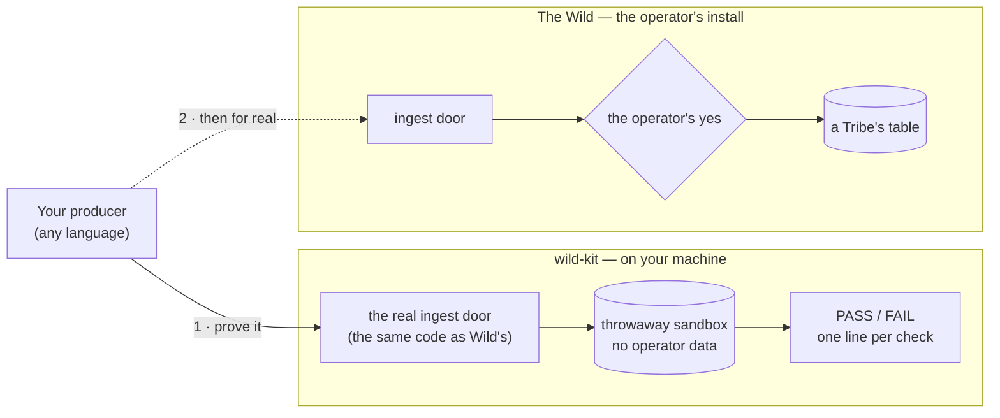

# wild-kit — get your own data into The Wild

## What it is

`wild-kit` is a small download for anyone who wants their own data in
The Wild: the battery of a laptop, a sensor in the office, the sessions
of a time tracker, the rows of an app's local database. The program
that sends such data is called a **producer**. You can write it
yourself in any language, or let a coding agent write it.

The kit runs Wild's real door for incoming data on your machine, in a
sandbox you throw away afterwards. Your producer talks to it exactly
as it would to a real Wild, and the kit tells you in plain sentences
whether it gets everything right. Wild itself does not have to be
installed.

## What you do with it

1. **Build.** `./wild-kit init`, then tell Claude Code, Codex or
   OpenCode which data you want in Wild. The agent asks you the rest
   and writes the producer.
2. **Prove.** `./wild-kit run` plays every hard case against the
   producer: a lost reply, a crash in the middle of a send, a paused
   door, a door that is not the right Wild. One line per check: `PASS`,
   or `FAIL` with what to fix.
3. **Hand over.** Once it passes, the operator pairs it with their Wild
   and says yes. From then on its data lands in a Tribe.



## Quick win: your Mac's battery, in five minutes

You send the charge of your Mac's battery into the kit's sandbox, by
hand, and see it land as a row. No code, no Wild install: a Mac with
Apple Silicon, `curl` and `jq` (both come with macOS) and two terminal
windows.

**1 · Get the kit and start its door.**

```bash
V=$(curl -s "https://api.github.com/repos/wildstuff/wild/releases?per_page=1" | jq -r '.[0].tag_name')
KIT=wild-kit-${V#v}-aarch64-apple-darwin
curl -LO https://github.com/wildstuff/wild/releases/download/$V/$KIT.tar.gz
curl -LO https://github.com/wildstuff/wild/releases/download/$V/$KIT.tar.gz.sha256
shasum -a 256 -c $KIT.tar.gz.sha256 && tar xzf $KIT.tar.gz && cd $KIT
./wild-kit serve --dir /tmp/wk
# wild-kit: serving the sandbox door on /tmp/wk/system/ingest.sock
```

Leave it running. Go on in the second window, in the same folder.

**2 · Say what you send.** A producer starts by describing its data:
its name, and for every field what it means. Save this as
`battery.json`:

```json
{
  "producer": "mac-battery",
  "version": "0.1.0",
  "contract_version": "1",
  "fingerprint": "my-mac",
  "sources": [{
    "slug": "battery",
    "description": "The charge of this Mac's battery.",
    "shapes": [{
      "name": "charge", "version": 1,
      "key_class": "natural", "key": ["at"],
      "target_type": "BatteryCharge",
      "description": "The battery's charge at one moment.",
      "fields": [
        {"name": "at", "kind": "timestamp", "required": true,
         "description": "When the charge was read."},
        {"name": "percent", "kind": "number", "required": true,
         "description": "The charge in percent, e.g. 87."},
        {"name": "on_power", "kind": "bool", "required": true,
         "description": "Whether the Mac was plugged in."}
      ]
    }]
  }]
}
```

The descriptions matter: Wild shows them to the operator, and its
assistant explains your data from them.

**3 · Announce yourself and take your key.**

```bash
door() { curl -s --unix-socket /tmp/wk/system/ingest.sock "$@"; }

ANN=$(door --json @battery.json http://door/api/v1/producers/announcements | jq -r .announcement)
KEY=$(door http://door/api/v1/producers/announcements/$ANN | jq -r .producer_key)
```

In a real Wild the operator says yes first. The sandbox says yes on its
own, so the key comes right away. The door hands it over once only.

**4 · Send what the battery says right now.**

```bash
P=$(pmset -g batt | grep -o '[0-9]*%' | tr -d %)
AC=$(pmset -g batt | grep -q "AC Power" && echo true || echo false)
echo "{\"shape\":\"charge@1\",\"record\":{\"at\":\"$(date -u +%FT%TZ)\",\"percent\":$P,\"on_power\":$AC}}" > now.ndjson

door -H "authorization: Bearer $KEY" -H 'content-type: application/x-ndjson' \
  --data-binary @now.ndjson \
  http://door/api/v1/tribes/sandbox/producers/mac-battery/sources/battery/batches
# {"batch":"77e47927…","state":"received","commit_mark":1,"pending":[],…}
```

`received`: the door holds your batch safely.

The `202` also carries `pending` — your oldest batches the door still
holds, each with its `state` and any per-line `conflicts` — and
`directives` when there is one; a refusal names its refused lines in
`rejected_lines`. The door's producer status (`connector_producer_status`, the
connection page the operator sees) adds `delivered.lines_refused`, the
count of lines the door did not take, and marks a shape no table of the
Tribe takes yet with `waits_for_model: true`: its records wait at the
door, and nothing is lost until the operator models the shape.

**5 · See it land.**

```bash
./wild-kit rows --dir /tmp/wk
# {"id":"dev-ab0fbb9f:charge:2026-11-04T09%3A05%3A44Z",
#  "lineage":"push:sandbox/mac-battery/dev-ab0fbb9f/77e47927…",
#  "record":{"at":"2026-11-04T09:05:44Z","on_power":true,"percent":100},
#  "shape":"charge@1"}
```

That is your battery, as a row. Three things came with it for free:

- **The row knows where it came from.** Its `lineage` names the batch
  it arrived in, so the operator can always ask "where is this from?".
- **Two Macs never collide.** The id starts with your connection
  (`dev-…`), so the same producer can run on many computers.
- **A re-send is harmless only while the answer is missing.** If the
  reply to a batch is lost, send that same batch again: the door
  recognises it by its id and answers from its receipt, so nothing is
  written twice. But an answer that did arrive decides. `received` means
  the door holds the batch durably: drop it from your outbox and never
  send it again. After a restart, read what the door already answered —
  your journal or outbox — before you read your data again; a batch
  answered `received` is not sent a second time.

**Next: let your coding agent build the real thing.** A producer that
sends every few minutes, keeps what the door has not taken yet and
survives a restart. In the same folder:

```bash
./wild-kit init
claude          # or codex, or opencode
```

Then say: *"Build a Wild connector for my Mac's battery."* The agent
asks a few short questions, writes the producer, and runs `wild-kit run`
on it until every check passes. How that goes:
[Let your coding agent build it](#let-your-coding-agent-build-it).

---

The rest of this page is the reference: every platform, what each
answer of the door means, the kit's report, and the road into the
operator's Wild.

## Rust: use the crate

A producer written in Rust takes the kit's producer library from
crates.io:

```sh
cargo add wild-kit serde_json
```

- [crates.io/crates/wild-kit](https://crates.io/crates/wild-kit) — the
  crate's README holds a first producer that compiles as it stands and
  runs against `wild-kit serve`: announce, take the key, send one record.
- [docs.rs/wild-kit](https://docs.rs/wild-kit) — the API documentation.
- [`wild-ingest-contract`](https://crates.io/crates/wild-ingest-contract)
  — the wire contract the library speaks, with the OpenAPI document and
  the JSON schemas, for a producer in any language.

The `wild-kit` **binary** (`serve`, `run`, `rows`, `pair`) is not in the
crate. It is commercially licensed and comes only as a download from
Wild's product releases; see the next section.

## Get the kit on any machine

Every release on
[github.com/wildstuff/wild/releases](https://github.com/wildstuff/wild/releases)
carries the kit beside Wild itself. Pick the version of the operator's
Wild and the machine **your producer** runs on:

| Your machine | Asset |
|---|---|
| macOS, Apple Silicon | `wild-kit-<version>-aarch64-apple-darwin.tar.gz` |
| Linux, x86-64 (any distribution — a static build) | `wild-kit-<version>-x86_64-unknown-linux-musl.tar.gz` |
| Linux, ARM64 (any distribution — a static build) | `wild-kit-<version>-aarch64-unknown-linux-musl.tar.gz` |
| Windows | not available yet |

Releases up to `v0.5.0-rc.26` do not carry the kit yet; take a later
one. Check the download against its `.sha256` (`shasum -a 256 -c` on
macOS, `sha256sum -c` on Linux) before you unpack it. `./wild-kit`
alone prints where to start and every command.

On macOS the kit is signed and notarized, so it opens without a
warning. A kit from an older release is not: if macOS says "Apple could
not verify 'wild-kit' is free of malware", run
`xattr -dr com.apple.quarantine wild-kit-<version>-<target>` once, then
start it again.

Inside you find `wild-kit` itself, its `LICENSE`, a short `README.md`,
and `ingest-contract/` — the contract the kit checks
(`v1/openapi.json` plus a JSON schema for every message). The
contract is Apache-2.0, so you may copy it into your own project.

A producer written in Rust takes the library instead; see
[Rust: use the crate](#rust-use-the-crate).

Keep the `--dir` of `wild-kit serve` short: the door listens on a Unix
socket inside it, and a socket path must stay under 104 bytes.

## How the door says no

A producer is judged mostly on what it does when the answer is *not*
a plain `received`. On the sandbox of the quick win, with `door` and
`$KEY` from step 3:

**A line that does not fit its shape** — answered `422`:

```bash
echo '{"shape":"charge@1","record":{"percent":"full"}}' |
door -H "authorization: Bearer $KEY" -H 'content-type: application/x-ndjson' \
  --data-binary @- \
  http://door/api/v1/tribes/sandbox/producers/mac-battery/sources/battery/batches
# {"error":"Lines of the batch do not fit their shape; nothing was received.",
#  "code":"batch_refused",
#  "rejected_lines":[{"line":1,"code":"field_missing","params":{"field":"at"}}], …}
```

Nothing of the batch was received — not even its good lines. Keep it,
fix what the reply names line by line, and re-post that same batch:
never write it to a new file, because a new file is a new batch Wild
has never seen.

**The same batch again after a lost reply** — answered from its
receipt, `received` while the door holds it and `processed` once it
ran, nothing written twice. That is the only sense in which sending
twice is harmless. Once an answer has arrived, do what it says: a batch
answered `received` leaves the outbox and is never sent again.

**A record you changed after sending it.** Send the same `at` again
with another `percent`: the door receives the batch, and a moment later
its state — asked with the `batch` id the door answered — carries a
conflict:

```bash
door -H "authorization: Bearer $KEY" --json '{"ids":["<batch>"]}' \
  http://door/api/v1/tribes/sandbox/producers/mac-battery/batches/status
# {"statuses":[{"batch":"d94dc060…","state":"processed",
#   "conflicts":[{"line":1,"code":"source_rewrote_history","params":{}}]}], …}
```

The first value stays. Wild keeps history; a record is a closed fact,
never a running total you rewrite later. A conflict is information —
never re-send because of one.

**A wrong key** is answered `401`. That is the answer a revoked
connection gets — ask your announcement before you send anything else.

## The names this guide uses

- **producer** — the program outside the Wild daemon that sends your
  records. This guide and every line `wild-kit run` prints call it that,
  and nothing else.
- **connection** — the same producer as the operator's app shows it after
  pairing: one program on one computer, under the name the operator gave
  it (German „Verbindung“). An answer's `device` names that paired
  install — its `dev-…` id, `POST …/device/epoch` — so read `device` in an
  answer as this word; the operator sees the id only under „Technische
  Angaben“.
- **connector** — the operator's word (German „Connector") for the
  program that delivers records into Wild, however it was built: Wild's
  own folder connector, one built inside Wild with Forge, or one an agent
  writes for you. It is not a second name for *producer* — that word, here
  and in every line the kit prints, is the program outside the Wild
  daemon that sends your records, the one you write yourself. "Build a
  Wild connector for…" is the operator asking an agent to decide which of
  the three the data needs.

## Put your producer through the kit

`wild-kit run` does what you did by hand, plus everything you would
never think of: a reply lost after the door received the batch, a
`503 paused` from the operator, the producer killed mid-send, a
truncated source file, the whole machine restored from a backup, a
Wild restored from an older backup, a cloned laptop, a door showing
the wrong certificate, and — for a producer that offers a function — a
call with no producer holding a wait, and the same call answered twice
under one `idempotency_key`.

Your producer takes its configuration from the command line. The kit
starts it once per scenario and fills in placeholders, so you keep your
own flag names:

| Placeholder | What the kit fills in | Needed |
|---|---|---|
| `{pairing}` | the path of a pairing file, written owner-only as Wild writes it: the door's address `http://127.0.0.1:<port>` (in the certificate scenarios an `https://` one with the `sha256:…` pin of its certificate) and a one-time code. Fresh at the machine's first start and after it lost its key; at every later start as your producer left it — read it, announce once, remove it, then send with the key. Persist the key the moment the poll hands it over, *before* the file goes: a producer that dies between removing the file and writing the key down is stranded (its next start has no code and no key, and the door answers `401`); only a fresh pairing recovers it | `{pairing}` or `{socket}` |
| `{socket}` | the door's Unix socket instead of TCP | `{pairing}` or `{socket}` |
| `{state}` | an empty directory of your producer's own — outbox, progress and, unless you name `{keys}`, the key too | always |
| `{source}` | an append-only text file the kit writes, for a producer that reads a log | optional |
| `{feed}` | a file the kit grows, a few lines between starts (before its only start in `late-yes`), from the lines you hand it with `--feed <file>` — for a producer that reads no file of its own, such as a stream. Each line is a different record: no two compose the same record id under the shape's `key_class` | optional; with `--feed` only |
| `{keys}` | a directory for the key alone, if you keep it apart from the state; two scenarios, `fresh-epoch` and `natural-reread`, apply only when your command names it, and are `SKIP` otherwise | optional |

`{state}` holds what your producer keeps, `{keys}` only its key. The
kit never writes `{keys}` itself — your producer does — but it copies the directory with the state in
the scenarios that copy or restore one, and empties it when the install
pairs anew. After a `rotate_key`, the file your producer reads its key
from must hold the new key: the kit starts your producer again on that
same directory, and the start after the rotation must present the new
key.

A producer that reads no append-only file — a network stream, a
queue — still has to be shown new input between its starts, or the
clone, the restored Wild and the expired receipt have nothing to
judge. Hand the kit lines with `--feed <file>` (one record per line,
each line a different record. Which fields make the id depends on the
shape's `key_class`: for `natural` it is the shape's declared `key`
fields, so two lines that agree on them are one record, whatever else
they say; for `position` it is the file and byte offset, so every line
is new; a `live` id is an epoch and counter your producer assigns, so
it never repeats. The kit counts distinct lines, not ids, so it does
not check that rule itself; it refuses a file with too few distinct
lines before it runs anything, and says why) and
read them in
your producer's command as `{feed}`:

```bash
./wild-kit run --dir /tmp/wk-run --feed ./sample-lines.txt -- \
  ./my-producer --pairing {pairing} --data-dir {state} --replay {feed}
```

The kit only ever appends to `{feed}`: a restore brings back your
state, never the feed, so a restored producer reads on from an older
place — a `natural` record read again lands on the id it had. One rule
decides what a missing input costs: a scenario that needs a file
(truncation, a half-written line, a rollback) is `SKIP` for a producer
that declares no `position` shape; one that needs new input is
`NOT MEASURED` until you name `{source}` or `{feed}`, and the line says
which. A restored Wild holding only part of your receipts also needs
one record that is not `live` — a `natural` or `position` record — in
the batches below the gap it forgot; without one the kit cannot tell
whether you send again what it already holds, and that check is
`NOT MEASURED` and asks for such a record.

```bash
./wild-kit run --dir /tmp/wk-run -- ./my-producer \
  --pairing '{pairing}' --data-dir '{state}'
```

`--dir` must be an empty directory. Each scenario starts your producer
from nothing on a fresh sandbox, lets it run until it has been quiet for
`--patience` seconds (default 5; a producer never exits on its own, the
kit stops it), and starts it again on the same state, as a restart would.
Quiet means not asking the door: announcing, polling for the
operator's yes, sending a batch and asking a batch's state each count as
activity, and so does a wait the last answer told it to keep
(`Retry-After`, `send_interval_secs`). A start's quiet begins only once
your producer has reached the door in it: until then it is still loading —
an interpreter, a JVM, a busy machine — and the kit waits up to 30 s (or
`--patience`, if longer) for it. A start that never opens a connection
costs that whole wait. Feed it **fixed, synthetic input** of
several batches: the kit compares what your producer sends under each
answer with what it sent on a clean run. The kit runs up to eight
scenarios at once, so keep everything a copy of your producer writes
or opens under the placeholders: a fixed port or lock file makes the
copies collide.

The report reads like this:

```
  PASS  received — 3 batches, 31 records received; every record reads back once, with the batch it came in as its lineage
  PASS  lost-reply — all 3 batches whose reply was lost were sent again as the same batch and answered from their receipts
  FAIL  unknown — 28 of 28 lines answered `202 unknown` were never sent again: the producer dropped them from its outbox,
        and Wild never received them (first: line 1 of batch 9b58edefa353). Keep a batch on anything but `received`,
        `processed`, `failed` or `expired`, and re-post that same batch — never a new file.
  PASS  kill — killed 3 times while a batch was on the way (2 before the door saw it, 1 after it received it), the producer
        got the same 31 lines to the door as on a clean run: none lost, none doubled
  SKIP  natural-reread — the producer's command names no {keys}: it keeps its key with its state, so a lost state is a
        lost key too, which `re-pair` covers
43 passed, 2 failed, 6 not measured, 6 skipped, 0 not built (the kit's gaps, not the producer's).
```

| Result | Meaning |
|---|---|
| `PASS` | your producer kept the rule |
| `FAIL` | it did not — the line says what happened and what to do instead |
| `SKIP` | the scenario does not apply to your producer (it declares no shape of that kind, names no `{keys}`, or announced `needs_vocabulary: false`, so a changed vocabulary owes it no fetch) |
| `NOT MEASURED` | it applies, but your producer gave the kit nothing to judge — e.g. it declares a log source and names no `{source}`, or reads no file and was handed no `--feed` |
| `NOT BUILT` | a scenario the kit does not play yet: **the kit's gap, not yours** |

The kit exits `0` only when every check passed or was skipped, so it
drops straight into CI. While you iterate, `--without late-yes` leaves
out the one scenario that holds the operator's yes back for 25 s; the
rest are done in seconds. A run that leaves a scenario out proves
nothing about it, so it never exits `0`: it exits `3` when every check
it played passed. When a check fails, everything that scenario saw
stays under `--dir`: your producer's output in
`/tmp/wk-run/<scenario>/`, and the rows it wrote via
`./wild-kit rows --dir /tmp/wk-run/<scenario>/sandbox`.

## Let your coding agent build it

An AI coding agent can write the producer, check it against the
contract and run the kit on it until it passes. You say what data you
want in Wild; the agent asks you the rest, builds and proves it. The
operator still gives the yes.

**Install the guide.** In the folder you unpacked the kit into:

```bash
./wild-kit init
# wild-kit: the guide for Claude Code and OpenCode is new: ./.claude/skills/wild-connector/SKILL.md
# wild-kit: the guide for Codex and OpenCode is new: ./.agents/skills/wild-connector/SKILL.md
# wild-kit: pairing files for connectors on this computer go in ~/.wild-kit/pairings, which only you can open
# …
# Start your agent in . and say what data should come into Wild, e.g. "Build a Wild connector for my Mac's battery". It asks you the rest.
```

The guide is a skill, `wild-connector`. Claude Code reads it from
`.claude/skills/`, Codex from `.agents/skills/`, OpenCode from both.
It names this kit by its path; after you move or update the kit, run
`./wild-kit init` again. `./wild-kit init --global` installs it under
your home directory, for every folder. A file of the same name that
`init` did not write stays as it is, and `init` says so. An assistant
that reads no skills gets the same guide as text: `./wild-kit prompt`
prints it, ready to paste.

**Start the agent and name your data.** One sentence is enough:

> Build a Wild connector for my Mac's battery.

The agent asks before it writes anything, one question at a time, each
with a default a short "yes" accepts:

| It asks | What the answer decides |
|---|---|
| what data, and where it lives | what to build — nothing new if Wild's folder connector reads it, a connector Wild builds inside itself (anything behind a login), or a producer you write yourself |
| how often it changes, how fresh it must be in Wild | how often the producer reads and sends |
| how much comes together, and whether the past comes along | how big a batch is, and how history goes out once, oldest first |
| where Wild runs, seen from here | how it reaches the door: the socket, or a pairing file |
| which language | Python 3, one file, standard library only, unless you say otherwise |

It never asks you about tribes, keys, batches or the door's limits —
those are its decisions, or the operator's. It says in three lines
what it will build and waits for your ok. Then it writes the producer,
runs `wild-kit run` until the kit exits 0, and tells you what it sends.
It does not start the producer against a real Wild: that is the
operator's step. Ask it *"How does it get into Wild?"* and it explains
the operator's road — the same as
[Connect it to a real Wild](#connect-it-to-a-real-wild).

### Connect the agent to Wild — optional, and worth it

Without Wild the kit alone is the judge. With it, the agent also reads
the Tribe's model, sees what a producer already announced, and asks the
door ahead of time what it would say to a batch. The operator connects
the agent, on the machine where Wild runs, while Wild's door for
producers is open (`wild ingest listen on --network` for an agent in a
VM or on another machine, `wild ingest listen on` for one on this
computer):

```bash
wild config mcp setup --agent --name connector-dev --tribe <tribe>
```

That makes the agent a key of its own. It reads the schema of the named
Tribes (name none and it reads every Tribe's schema), checks batches
and proposes. It reads no record, and nothing it proposes takes effect
before the operator's yes. It works on Wild's MCP doors only; Wild's
REST door refuses it. `wild user rm connector-dev` takes it back.

The key is never shown. Wild writes it, with the door's address and
the fingerprint of the door's certificate, into the agent's
**connection**: a file readable by the operator alone, whose path the
command prints. Bring it to the agent's computer the way a pairing file
goes: copy the file to
`~/.wild-kit/pairings/agents/connector-dev.json`, or copy its text and
paste it into `wild-kit paste-agent connector-dev` in a terminal of your
own there — it reads from a terminal only and shows nothing of what is
pasted. `wild-kit init` keeps the coding agents' file tools out of that
place.

The agent's MCP client then starts the kit as a local server:
`wild-kit mcp connector-dev`. The kit reads the connection, trusts
exactly the certificate whose fingerprint it names, and sends the key
itself, so the key reaches no prompt, no config the agent reads, and no
LLM:

- **Claude Code** — `claude mcp add wild -- wild-kit mcp connector-dev`
- **OpenCode** — in `opencode.json`:
  `"mcp": { "wild": { "type": "local", "command": ["wild-kit", "mcp", "connector-dev"] } }`
- **Codex** — in `~/.codex/config.toml`:

  ```toml
  [mcp_servers.wild]
  command = "wild-kit"
  args = ["mcp", "connector-dev"]
  ```

A door that shows another certificate is not the Wild the agent was
connected to: the kit sends it nothing, and the agent is told so.

That bound holds only where the agent cannot read the operator's Wild
profile. An agent running as the operator, on the operator's machine,
can read what the operator can, the installation's own token among it.
So run the agent as a separate OS user, in a container or VM, or on
another machine, and keep the profile's `system/` folder and Wild's
three sockets (`runtime.sock`, `api.sock`, `ingest.sock`) out of its
reach; `wild doctor` prints where each of them is.

Over MCP, Wild serves the same guide as the prompt
`wild.build_a_connector`: the steps in `wild-kit init`'s skill are that
prompt's, so the two never tell an agent different things.

## Try it from another machine

A producer on the operator's own machine talks to the socket. One on
another machine — or in a virtual machine — dials the door over TCP
and proves itself with a one-time **pairing code**:

```bash
./wild-kit serve --dir /tmp/wk-net --listen 127.0.0.1:7600
# wild-kit: and on http://127.0.0.1:7600 — a producer announcing itself there needs `wild-kit pair --dir /tmp/wk-net`
./wild-kit pair --dir /tmp/wk-net
# wdp_89cefa2b_b1b63377cd8c8485a4e2af0806546626
curl -s -H "wild-pairing-code: wdp_89cefa2b_…" --json @battery.json \
  http://127.0.0.1:7600/api/v1/producers/announcements
```

The code is valid for ten minutes and opens one announcement; without
it the door answers `401`. The kit's TCP door is plain HTTP and listens
on loopback only — only a QEMU VM with user-mode networking reaches
your Mac's loopback, at `10.0.2.2`; a VM on a shared or bridged network
needs a Wild's door on the local network. A producer built on the
`wild_kit` library takes a plain `http://` door at exactly those two
places — loopback, and `10.0.2.2` — and refuses any other, because plain
HTTP carries the pairing code and the key in the clear. A real Wild on the local
network speaks only TLS with a certificate of its own, which your
producer **pins**: it compares the SHA-256 of the certificate the door
shows with the fingerprint its pairing file names, before it writes a
single byte. `wild-kit run` checks that in its `pinned` and `wrong-pin`
scenarios.

## Connect it to a real Wild

Your producer passes the kit. Now it meets a real Wild, and from here
on the operator decides. The road has four stops; the table after them
names where operators trip today.

**1 · A Tribe that can take the data.** A producer's records land in
the business objects of a Tribe's domain model, and the operator models
those with the Elder: your shapes are what you deliver, never a copy
the model takes over. When no Tribe has a model yet, the inbox question
offers *Found a tribe for it*: that one yes founds a Tribe named after
the producer and lets the producer in. It makes no table and starts
nothing. From a terminal it is
`wild ingest activate <announcement> --new-tribe`. An operator who
wants the data in a Tribe of their own making creates it in the chat
first and answers the question with its name.

What you deliver before anything takes it is not lost: the door answers
`received` and keeps it, and the Tribe's chat tells the operator what
waits. Once the operator and the Elder model a business object that
takes a shape, what waited of it lands.

A Tribe whose model already takes one of your shapes, declared
otherwise than you announce it now, refuses the yes: *"… the producer
must announce a new version"*. Change a shape only under a new version.

**2 · The door, by where the producer runs.**

| The producer runs | The operator | The producer starts with |
|---|---|---|
| on the operator's machine | does nothing; `wild ingest address` prints the socket | the same start line with the socket: `--door <profile>/system/ingest.sock` (the reference producer takes it; no code, nothing to open) |
| in a virtual machine, or on another computer in the network | runs `wild ingest listen on --network`, then `wild ingest pair --name <name>` — or in the dashboard: a Tribe's *Settings → Connections → Pair another connection* | `--pairing ~/.wild-kit/pairings/<name>.json`: the pairing file Wild wrote, brought to that machine |

The pairing file is how the door, its certificate's fingerprint and the
one-time code reach your producer without passing through a prompt
(ADR-0365 D1 amendment, step 4). Wild writes it on its own machine,
readable by the operator's user alone, at
`<profile>/system/ingest/pairings/<connection>.json` — `buero-laptop.json`
for the connection „Büro-Laptop“ — and every surface names only that
path, never the code. Nobody pastes its contents into a chat: the code
in it is a key.

On the producer's machine the file has one place,
`~/.wild-kit/pairings/<name>.json`, outside every folder a coding agent
works in; `wild-kit init` makes it and forbids Claude Code to read it.
The operator brings it there one of two ways: copies the file, or presses
„Kopplungstext kopieren“ in the dashboard's pairing dialog and pastes the
text into `wild-kit paste-pairing <name>` in a terminal of their own,
which reads without echo and refuses a pipe or an agent's shell. The
reference producer refuses a pairing file inside a folder with `.git`,
`.claude` or `.agents` and says where it belongs; a producer of your own
should do the same. The operator's three steps:
`pair-a-connector.md`.

The reference producer's two start lines, side by side:

```bash
# on the same machine: the socket, no code
./wild-kit-reference-producer --door <profile>/system/ingest.sock --state ./state
# paired, over the network: the same command on every start
./wild-kit-reference-producer --pairing ~/.wild-kit/pairings/buero-laptop.json --state ./state
```

It sends synthetic sensor readings. `--sample host-fleet` sends instead
a made-up fleet of hosts and agents over three minutes, as a host
producer would. Its keys: `host_load` (each host's load, one row a
minute) and `agent_status` (an agent's status as it changed, and every
agent's on the first minute, as a reconnect gives) are `live`;
`token_use` (the tokens one model message used, never its content) is
`natural` on the message and request id. A transcript repeats one
message's usage on several lines, so the producer sends it once, and
the key makes a message read again after a lost state the record it
was. `wild-kit run` holds this sample to every scenario, as it holds
the readings.

The host fleet also offers one function, `agent_start` (ADR-0398): its
manifest announces it under `tools:`, and once the producer is let in
it holds a call wait on the door. A call to start an agent on a host of
the fleet is answered `{"outcome": "started", "agent": …}`, and the
agent shows in the next batch's `agent_status`. A host the fleet does
not have is answered `{"outcome": "refused", "reason": …}` and starts
nothing. Your own producer gets this half from the kit's library,
`wild_kit::producer::calls`: one handler per function; a call no handler
takes is answered `refused`, never dropped; the wait opens again at
once after an answer or an empty hold, and after a pause when the door
did not answer. `crates/wild-kit/samples/host-fleet/model.yaml` is a
model whose command „Agent starten“ calls the function and reads those
two answers as its outcomes.

The kit's sandbox calls it too: for a producer that announces a
function it plays the call half, six scenarios that reach your producer
over the door's real call route. Each starts your producer on a fresh
sandbox, calls the function the announced schema gives — with the
arguments its `examples` name, and an `idempotency_key` of its own:

| Scenario | What it proves |
|---|---|
| `call-answered` | the call travels on the wait your producer holds, an answer comes back, and your producer's own output names the same `outcome` |
| `call-unreachable` | with no producer holding a wait, the call is `unreachable` within 10 s and nothing was sent: asking again is safe |
| `call-refused` | a function your producer never announced is answered `refused` — the command's failure outcome, never `unknown` — and nothing runs |
| `call-repeat` | a second call under the same key with the same arguments runs nothing and answers as before |
| `call-other-arguments` | the same key with other arguments answers `refused`, and nothing runs |
| `call-after-crash` | an answer Wild gave up waiting for is kept, so the same call after a restart runs nothing twice |

Every key your producer answers is kept for seven days
(`wild_kit::producer::calls` does this for you: one handler per
function and nothing else). A producer that announces no function has
no call half; those six rows then say `SKIP` — the scenario does not
apply to it, it is not a gap.

The door records the end of every wait, so a producer that held none for
a minute is said out of reach in the operator's own words — „fleet2 ist
seit 4 Minuten nicht erreichbar" — on the connection detail, on the Atlas
and to the Elder; a call refused for it says the same and lands
`unreachable`. Only a call that could not be sent makes an inbox row: a
producer going quiet makes none.

A call may also name a `task`: the started agent goes to its tribe's
`/mcp` view with the producer's own `device` key (ADR-0398 D13) — the
surface the operator's yes switches on — and claims the task, reports it
and closes it with a pull request. The answer goes back first; the agent
then waits until the record has left `starting` — the flow's own 60 s,
plus the one read it had in flight when that window closed — because a
command on a record in another command's open state is refused until that
command's effect has answered (ADR-0370 Amendment 2 D21). A read the
tribe could not answer is no answer about the task, so it keeps looking;
when the window runs out the claim is still asked once. A refusal is said
in the tribe's own words and the agent stops there, with nothing further
claimed, reported or closed.
`wild_kit::producer::mcp` is that client: one session, `tools/list` and
`tools/call`, nothing more. A producer started with
`--door` reaches Wild only by the socket, which serves no view, so a call
naming a task is refused rather than answered with an agent that could
do nothing.

The producer's own key opens that view too. A producer key begins
`wdk_`, and only the ingest listener takes one: the listener answers
MCP at its own address with `/mcp` after it — `https://<door>/mcp` — and
a key from the operator's yes is a bearer there, landing as the
connection of its tribe (ADR-0398 D13). There it reaches the Tribe's own
domain tools — the `atlas_*` reads of its types and the commands the
Tribe declares — and nothing host-level. Wild's other MCP door, the one
the operator's own `/mcp` serves, refuses that key with `missing or
invalid bearer token`: a producer's key is not an operator key.

At its first start the producer reads the file, keeps the door and its
fingerprint with its key, announces itself, and removes the file once
its state holds the announcement — the key and its epoch. Do not remove
it earlier: until the poll has handed the key over, the code in the
file is the only way in, and the file holds for ten minutes and opens
one announcement. Every later start, with the same command, finds the
file gone and takes the door it kept. A `--door` is a socket path only;
an address there is refused and sent to the pairing file. A door the
producer cannot reach is said in words — "could not reach Wild at …",
"no Wild door at …; is Wild running?" — with what to try first (a VM
usually needs the door on „Lokales Netz“) and the system's own error
last.

**3 · The announcement and the yes.** The producer announces itself
and polls. It shows up dashed in the operator's Atlas and as a
question in the inbox (the dashboard, or `wild watch`). It sends
nothing yet. If its manifest names the Tribe (`"tribe": "devices"`),
the question offers it directly: *Let it deliver* or *Reject*.
Without a Tribe in the manifest, the operator answers with the
Tribe's name, or from a terminal:

```bash
wild ingest announcements                         # who announced itself, and where each stands
wild ingest activate <announcement> --tribe <tribe>
wild ingest activate <announcement> --new-tribe   # a Tribe of its own, founded; its deliveries wait to be modelled
```

The yes is the operator's act; the agent's key cannot give it. At
its next poll the producer receives its key and delivers. The yes may
come days later, so the producer keeps polling.

**4 · Rows land once a business object takes them and the Tribe
runs.** The operator models, with the Elder in the Tribe's chat, what
your data means for the Tribe. With its first business object the
Tribe can start, and the yes already gave it its success check, so the
start needs only the operator's click. A Tribe that is not running
holds what it delivers: *"The program is let in, but Devices is not
running right now. Its deliveries wait and arrive once Devices runs."*

From then on the operator can pause, resume, revoke or erase your
program's connection — your `device` — at any time (`wild ingest pause` · `resume` · `revoke` ·
`erase`). A pause is answered `503 paused`: keep the batches, they go
out once resumed, with the same key.

Recommend installing your producer as a service of the operator's own
user — a launch agent on macOS, a `systemd --user` unit on Linux. That
step is theirs.

### Where it trips today

| The operator sees | Why | Do |
|---|---|---|
| *"No tribe in this profile has a domain model yet …"* | the yes needs a Tribe with a model | answer *Found a tribe for it* (or `--new-tribe`), or create a Tribe in the chat first (stop 1) and answer with its name |
| *"… is founded and … is let in, but …"*, ending *"Answer again to go on from here."* | a step after the founding stopped, and says why | answer again: it goes on with the same Tribe and founds no second one |
| *"… the producer must announce a new version"* | the Tribe's model already takes a shape of the producer, declared otherwise than the producer announces it now | announce the changed shape under a new version |
| the producer delivers, and no row lands | no business object takes its shapes yet: they wait at the door | model what the data means with the Elder in the Tribe's chat (stop 4) |
| *"… is not running right now. Its deliveries wait …"* | the Tribe is stopped | start it in its chat (stop 4) |
| *"… does not start yet: it is not settled how you tell that its work went well …"* when starting the Tribe | a Tribe starts only once it is clear how you tell its work went well | tell the Elder in a plain sentence what must hold |
| the producer stopped before the yes | it gave up polling | it must keep polling; start it again on the same state and it picks its announcement back up |
| the producer says *"the pairing file … lies in …, a folder a coding agent works in"* | the file was put in the project folder, where the agent reads it and git commits it | move it to `~/.wild-kit/pairings/` and start with that path |
| the producer says *"the pairing file … is not there, and this install kept no door from an earlier one"* | the file was removed or never copied before the producer's first start | pair the connection again (`wild ingest pair --name <name>`) and start the producer with the new file |
| in Claude Desktop or another MCP client, a step waits to be released | an MCP client cannot release a step the Elder staged | release it in the dashboard's inbox or in `wild watch` |

## Rules of thumb your producer must keep

The kit checks all of these; knowing them up front saves runs.

- **Keep a batch until it is `received`, `processed`, `failed` or
  `expired`.** Anything else — a refusal, a `429`, a `503`, a state or
  code you do not know — means *not taken*: keep it, wait the
  `Retry-After`, and re-post that same batch — the same file under the
  same id, never rewritten into a new one. Re-posting a batch never
  replaces an earlier copy of it.
- **Write the batch to disk before you send it, and file the door's
  answer beside it.** A crash mid-send must lose nothing and double
  nothing. On every start, read what the door already answered before
  you read your data again: a batch answered `received` has left the
  outbox — never send it again. A re-send is harmless only for a batch
  whose answer never arrived: the door recognises it by its id.
- **Send closed records only**, each once, under a stable key. Changing
  a record you sent is refused (`source_rewrote_history`).
- **Follow every directive** in every reply: `paused`, `rotate_key`,
  `send_interval_secs`, `new_epoch`, `vocabulary_changed` (owed only
  when you announced `needs_vocabulary: true`, and only once you have
  fetched the vocabulary at least once: it says the copy you hold is no
  longer the one served, and fetching the current copy stops it). So
  fetch the vocabulary once at every start, before your first batch — a
  producer that has never fetched is owed nothing, and one that waits
  for the directive before fetching waits forever. A directive arrives
  during a run, and no new line arrives while your producer is running:
  to be measured, act on it in that same run, and each directive needs
  its own later request there — at least one more batch for `paused`,
  `rotate_key`, `send_interval_secs` and a restore, a retry you keep back
  or a loop that keeps reading; a later `live` record under the new epoch
  for `new_epoch`; and the vocabulary fetched again for
  `vocabulary_changed`. Otherwise the check is `NOT MEASURED` and names
  what it still needs.
- **A `401` is a question, not a stop.** Ask your announcement
  (`GET …/producers/announcements/{announcement}`): `revoked` or
  `rejected` ends it for good; any other state means keep going.
- **Pin the door's certificate** on `https://`, and never fall back to
  `http://`. Take a plain `http://` door only on loopback, or at
  `10.0.2.2` from a QEMU user-mode VM — the kit's own door.
- **A changed shape is a new version** (`charge@2`); the door takes
  only the versions the Tribe binds.

## When something goes wrong

| You see | It means | Do |
|---|---|---|
| `the sandbox directory is too deep for a socket` | the socket path would exceed 104 bytes | give `--dir` a short path, e.g. `/tmp/wk` |
| `… is not a loopback address` | `--listen` named another interface; the kit serves no TLS | listen on `127.0.0.1`; from a QEMU user-mode VM dial `10.0.2.2` |
| `… names a plain http:// door at …, which is not on this computer` | the pairing file names plain HTTP somewhere other than loopback or `10.0.2.2` | for the kit, name `http://127.0.0.1:<port>` (or `http://10.0.2.2:<port>` inside a QEMU user-mode VM); for a Wild on the network, take the pairing file for its `https://` door |
| `401` on an announcement | over TCP without a valid pairing code, or the code is older than ten minutes | `./wild-kit pair --dir …` again |
| `401` on a batch | the key is wrong or revoked | ask the announcement for its state; send nothing more only on `revoked` or `rejected` |
| `422 batch_refused` | a line does not fit its shape; `rejected_lines` names each one | fix the lines, send the batch again |
| `FAIL` lines on `wild-kit run` | your producer broke a rule | the line names the rule; fix and re-run |
| `NOT BUILT` | the kit does not play that scenario yet | nothing — it is the kit's gap |

> 🔍 **Dig deeper — the ingest contract and the door.**
>
> - **Contract:** [`ingest-contract/v1/openapi.json`](ingest-contract/v1/openapi.json) — every route, reply and schema; its `info.description` is the producer's guide, including every scenario `wild-kit run` plays. Apache-2.0 ([`ingest-contract/LICENSE`](ingest-contract/LICENSE)).
> - **Concept:** ADR-0365 — an external source streams records into a Tribe.
> - **CLI:** `wild ingest address` · `listen` · `pair` · `announcements` · `activate` · `pause` · `resume` · `revoke` · `erase` — [`cli.md`](cli.md) § Producer ingest door.
> - **On disk:** the door's socket is `<profile>/system/ingest.sock`; the kit's sandbox is the `--dir` you give it — delete it when you are done.
