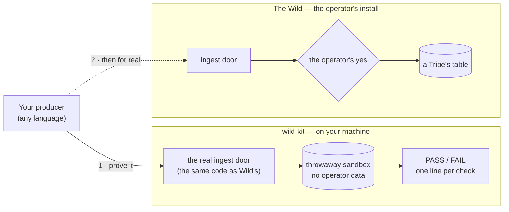

# wild-kit — prove your producer before it touches a real Wild

You wrote a small program that sends data into The Wild — readings
from a sensor, sessions from a time tracker, rows from an app's local
database. Before an operator lets it near their Tribes, you want to
know it behaves: that it keeps a batch the door did not take, never
sends one twice, survives a crash halfway through a send, and refuses
a door that is not the Wild it was paired with.

`wild-kit` tells you, in about half a minute, in plain sentences. It
runs **the real ingest door** — the same code as inside Wild — on a
throwaway sandbox on your own machine, plays every hard case against
your program, and prints one line per check: `PASS`, or `FAIL` with
what went wrong and what to do instead. Wild does not need to be
installed where you run it.

A program like yours is called a **producer**: anything outside the
Wild daemon, in any language, that streams closed records into a
Tribe through the ingest door.



The page is a ladder of quick wins. Each one takes a few minutes and
leaves you with something that works:

| # | Quick win | Time | You end with |
|---|---|---|---|
| 1 | [Get the kit](#1--get-the-kit) | 2 min | a verified `wild-kit` on your machine |
| 2 | [Send your first record by hand](#2--send-your-first-record-by-hand) | 5 min | two rows in a sandbox, sent with `curl` |
| 3 | [See how the door says no](#3--see-how-the-door-says-no) | 3 min | the three answers every producer must handle |
| 4 | [Put your producer through the kit](#4--put-your-producer-through-the-kit) | 1 min a run | a pass/fail report you iterate on |
| 5 | [Let Claude Code, Codex or OpenCode build it](#5--let-claude-code-codex-or-opencode-build-it) | 10 min | a producer an agent built with you, step by step, and the kit passed |
| 6 | [Try it from another machine](#6--try-it-from-another-machine) | 3 min | a producer that pairs over TCP |
| 7 | [Connect it and let the operator allow it](#7--connect-it-and-let-the-operator-allow-it) | 10 min | your producer delivering into a real Tribe |

## 1 · Get the kit

Every release on
[github.com/wildstuff/wild/releases](https://github.com/wildstuff/wild/releases)
carries the kit as its own download beside Wild itself — pick the
version of the operator's Wild and the machine **your producer** runs
on:

| Your machine | Asset |
|---|---|
| macOS, Apple Silicon | `wild-kit-<version>-aarch64-apple-darwin.tar.gz` |
| Linux, x86-64 (any distribution — a static build) | `wild-kit-<version>-x86_64-unknown-linux-musl.tar.gz` |
| Linux, ARM64 (any distribution — a static build) | `wild-kit-<version>-aarch64-unknown-linux-musl.tar.gz` |
| Windows | not available yet |

Releases up to `v0.5.0-rc.26` do not carry the kit yet; take a later
one.

Check the download against its `.sha256`, then unpack it:

```bash
shasum -a 256 -c wild-kit-<version>-<target>.tar.gz.sha256    # macOS
sha256sum -c wild-kit-<version>-<target>.tar.gz.sha256        # Linux
tar xzf wild-kit-<version>-<target>.tar.gz
cd wild-kit-<version>-<target>
./wild-kit            # where to start, and every command
```

Inside you find `wild-kit` itself, its `LICENSE`, a short `README.md`,
and `ingest-contract/` — the contract the kit checks
(`v1/openapi.json` plus a JSON schema for every message). The
contract is Apache-2.0, so you may copy it into your own project.

## 2 · Send your first record by hand

Before you write any code, walk the whole road once with `curl`. It
is four requests, and afterwards you know exactly what your producer
has to do.

**Start the door** on a fresh sandbox. Keep the directory short —
the door listens on a Unix socket inside it, and a socket path must
stay under 104 bytes:

```bash
./wild-kit serve --dir /tmp/wk
# wild-kit: serving the sandbox door on /tmp/wk/system/ingest.sock
```

Leave it running and open a second terminal.

**Describe what you send.** A producer starts by announcing itself
with a *manifest*: its name, its sources, the shapes of the records
each source sends, and what every field means. Save this as
`manifest.json`:

```json
{
  "producer": "hello-producer",
  "version": "0.1.0",
  "contract_version": "1",
  "fingerprint": "my-laptop",
  "sources": [{
    "slug": "readings",
    "description": "Temperature readings from the sensors in the office.",
    "shapes": [{
      "name": "reading", "version": 1,
      "key_class": "natural", "key": ["sensor", "at"],
      "target_type": "Reading",
      "description": "One temperature reading.",
      "fields": [
        {"name": "sensor", "kind": "text", "max_len": 32, "required": true,
         "description": "The sensor's name, e.g. office-1."},
        {"name": "at", "kind": "timestamp", "required": true,
         "description": "When the reading was taken."},
        {"name": "value", "kind": "number", "required": true,
         "description": "The temperature in degrees Celsius, e.g. 21.5."}
      ]
    }]
  }]
}
```

The descriptions are not decoration: Wild carries each one onto the
table's field, and the operator — and Wild's assistant — map and
explain your data from them. Write them in the operator's words, with
the unit and an example.

**Announce.** On the socket no pairing code is needed:

```bash
curl -s --unix-socket /tmp/wk/system/ingest.sock \
  -H 'content-type: application/json' --data @manifest.json \
  http://door/api/v1/producers/announcements | tee announced.json
# {"announcement":"b2388fe4634daebc","profile":"wild-kit-sandbox","state":"activated"}
ANN=$(jq -r .announcement announced.json)
```

(`http://door` is any host name: over a socket `curl` only needs one
to form the URL.)

In a real Wild the announcement now reads `pending` until the operator
says yes. The kit's sandbox says yes on its own, so you can go on at
once.

**Fetch your key.** Ask for the announcement; the answer hands over
your `producer_key` and `epoch` **exactly once**, so keep them:

```bash
curl -s --unix-socket /tmp/wk/system/ingest.sock \
  http://door/api/v1/producers/announcements/$ANN | tee key.json
# {"announcement":"b2388fe4634daebc", … ,"tribe":"sandbox","device":"dev-2cdff6b1",
#  "producer_key":"wdk_4294b8ca…","epoch":"1cd02971…"}
KEY=$(jq -r .producer_key key.json)
```

The `device` in that answer is what the operator's app shows as your
**connection** (German „Verbindung“): one program on one computer, shown
by the name the operator gave it at pairing (`wild ingest pair --name
"Büro-Laptop"`), or unnamed by where it runs. The contract and its wire keep
the word `device` (and `computer` for that name); the operator never reads
the `dev-…` id except under „Technische Angaben“.

Ask a second time and the key is no longer in the answer — the door
gave it to you, and only to you. (The commands here use `jq` to pick a
value out of a reply; without it, copy the value by hand.)

**Send a batch.** One NDJSON line per record, each naming its shape
and version:

```bash
cat > batch.ndjson <<'EOF'
{"shape":"reading@1","record":{"sensor":"office-1","at":"2026-10-26T09:00:00Z","value":21.5}}
{"shape":"reading@1","record":{"sensor":"office-2","at":"2026-10-26T09:00:00Z","value":19.0}}
EOF
curl -s --unix-socket /tmp/wk/system/ingest.sock \
  -H "authorization: Bearer $KEY" -H 'content-type: application/x-ndjson' \
  --data-binary @batch.ndjson \
  http://door/api/v1/tribes/sandbox/producers/hello-producer/sources/readings/batches
# {"batch":"a03486d8…","state":"received","commit_mark":1,"pending":[],
#  "directives":{"vocabulary_changed":false,"paused":false}, …}
```

`received` means Wild holds the batch durably — you may drop it from
your outbox now.

**Look at what landed:**

```bash
./wild-kit rows --dir /tmp/wk
# {"id":"dev-2cdff6b1:reading:office-1:2026-10-26T09%3A00%3A00Z",
#  "lineage":"push:sandbox/hello-producer/dev-2cdff6b1/a03486d8…",
#  "record":{"at":"2026-10-26T09:00:00Z","sensor":"office-1","value":21.5},"shape":"reading@1"}
# …and the same for office-2
```

Two things to notice. The id is your record's own key (`sensor`,
`at`), prefixed with your **device** — so two laptops running your
producer never collide. And every row carries its **lineage**, the
batch it came in: an operator can always ask where a fact came from.

## 3 · See how the door says no

A producer is mostly judged on what it does when the answer is *not*
a plain `received`. Try the three answers you will meet first, on the
same sandbox.

**A line that does not fit its shape.** Leave out a required field:

```bash
echo '{"shape":"reading@1","record":{"sensor":"office-1","value":"warm"}}' |
curl -s --unix-socket /tmp/wk/system/ingest.sock \
  -H "authorization: Bearer $KEY" -H 'content-type: application/x-ndjson' \
  --data-binary @- \
  http://door/api/v1/tribes/sandbox/producers/hello-producer/sources/readings/batches
# HTTP 422:
# {"error":"Lines of the batch do not fit their shape; nothing was received.",
#  "code":"batch_refused",
#  "rejected_lines":[{"line":1,"code":"field_missing","params":{"field":"at"}}], …}
```

Nothing of the batch was received — not even its good lines. Keep it,
fix what the reply names line by line, and send it again.

**The same batch twice.** Send `batch.ndjson` again. The door
recognises it by its content and answers from its receipt —
`"state":"processed"`, nothing written twice. A reply lost on the
way is therefore harmless: when in doubt, send again.

**A record you changed after sending it.** Send `office-1` at
`09:00:00Z` again with another value — the door receives the batch —
then, a moment later, ask for its state:

```bash
BATCH=$(echo '{"shape":"reading@1","record":{"sensor":"office-1","at":"2026-10-26T09:00:00Z","value":22.0}}' |
  curl -s --unix-socket /tmp/wk/system/ingest.sock \
    -H "authorization: Bearer $KEY" -H 'content-type: application/x-ndjson' \
    --data-binary @- \
    http://door/api/v1/tribes/sandbox/producers/hello-producer/sources/readings/batches |
  jq -r .batch)
curl -s --unix-socket /tmp/wk/system/ingest.sock \
  -H "authorization: Bearer $KEY" -H 'content-type: application/json' \
  -d "{\"ids\":[\"$BATCH\"]}" \
  http://door/api/v1/tribes/sandbox/producers/hello-producer/batches/status
# {"statuses":[{"batch":"d94dc060…","state":"processed",
#   "conflicts":[{"line":1,"code":"source_rewrote_history","params":{}}]}], …}
```

The first value stays. Wild keeps history; a record is a closed fact,
never a running total you rewrite later. A conflict is information —
never re-send because of one.

And one more: a wrong key is answered `401`. That is the answer a
revoked connection gets — stop sending.

## 4 · Put your producer through the kit

Now let the kit do what you just did by hand, plus everything you
would never think of: a reply lost after the door received the batch,
a `503 paused` from the operator, the producer killed mid-send, a
truncated source file, the whole machine restored from a backup, a
Wild restored from an older backup, a cloned laptop, a door showing
the wrong certificate.

Your producer has to take its configuration from the command line.
The kit starts it once per scenario and fills in placeholders, so you
keep your own flag names:

| Placeholder | What the kit fills in | Needed |
|---|---|---|
| `{pairing}` | the path of a pairing file, written owner-only as Wild writes it: the door's address `http://127.0.0.1:<port>` (in the certificate scenarios an `https://` one with the `sha256:…` pin of its certificate) and a one-time code. Fresh at the machine's first start and after it lost its key; at every later start as your producer left it — read it, announce once, remove it, then send with the key | `{pairing}` or `{socket}` |
| `{socket}` | the door's Unix socket instead of TCP | `{pairing}` or `{socket}` |
| `{state}` | an empty directory of your producer's own — its key, outbox, progress | always |
| `{source}` | an append-only text file the kit writes, for a producer that reads a log | optional |
| `{keys}` | a directory for the key alone, if you keep it apart from the state | optional |

Then run it:

```bash
./wild-kit run --dir /tmp/wk-run -- ./my-producer \
  --pairing {pairing} --data-dir {state}
```

`--dir` must be an empty directory. Each scenario starts your producer
from nothing on a fresh sandbox, lets it run until it exits or stays
quiet for `--patience` seconds (default 5), and starts it again on the
same state, as a restart would. Feed it **fixed, synthetic input** of
several batches: the kit compares what your producer sends under each
answer with what it sent on a clean run.

The report reads like this:

```
  PASS  received — 3 batches, 31 records received; every record reads back once, with the batch it came in as its lineage
  PASS  lost-reply — all 3 batches whose reply was lost were sent again as the same batch and answered from their receipts
  FAIL  unknown — 28 of 28 lines answered `202 unknown` were never sent again: the producer dropped them from its outbox,
        and Wild never received them (first: line 1 of batch 9b58edefa353). Keep a batch on anything but `received`,
        `processed` or `failed`.
  PASS  kill — killed 3 times while a batch was on the way (2 before the door saw it, 1 after it received it), the producer
        got the same 31 lines to the door as on a clean run: none lost, none doubled
  SKIP  natural-reread — the producer's command names no {keys}: it keeps its key with its state, so a lost state is a
        lost key too, which `re-pair` covers
43 passed, 2 failed, 6 not measured, 6 skipped, 0 not built (the kit's gaps, not the producer's).
```

What each word means:

| Result | Meaning |
|---|---|
| `PASS` | your producer kept the rule |
| `FAIL` | it did not — the line says what happened and what to do instead |
| `SKIP` | the scenario does not apply to your producer (it declares no shape of that kind, or names no `{keys}`) |
| `NOT MEASURED` | it applies, but your producer gave the kit nothing to judge — e.g. it declares a log source and names no `{source}` |
| `NOT BUILT` | a scenario the kit does not play yet: **the kit's gap, not yours** |

The kit exits `0` only when every check passed or was skipped, so it
drops straight into CI. While you iterate, `--without late-yes` leaves
out the one scenario that holds the operator's yes back for 25 s; the
rest are done in seconds. A run that leaves a scenario out proves
nothing about it, so it never exits `0`: it exits `3` when every check
it played passed. When a check fails, everything that scenario
saw stays under `--dir`: your producer's output in
`/tmp/wk-run/<scenario>/`, and the rows it wrote via
`./wild-kit rows --dir /tmp/wk-run/<scenario>/sandbox`.

## 5 · Let Claude Code, Codex or OpenCode build it

An AI coding agent can write the producer, check it against the
contract and run the kit on it until it passes. You say what data you
want in Wild; the agent asks you the rest, builds, proves — and when
you ask how it gets into Wild, explains the operator's side. The
operator still gives the yes.

**Install the guide.** Make a new folder, unpack the kit into it (see
[quick win 1](#1--get-the-kit)) and run:

```bash
./wild-kit init
# wild-kit: the guide for Claude Code and OpenCode is new: …/.claude/skills/wild-connector/SKILL.md
# wild-kit: the guide for Codex and OpenCode is new: …/.agents/skills/wild-connector/SKILL.md
#
# Start your agent in … and say what data should come into Wild, e.g. "Build a Wild connector for my Mac's battery". It asks you the rest.
```

The guide is a skill, `wild-connector`. Claude Code reads it from
`.claude/skills/`, Codex from `.agents/skills/`, OpenCode from both.
It names this kit by its path, so the agent runs the kit you
installed; after you move or update the kit, run `./wild-kit init`
again. `./wild-kit init --global` installs it under your home
directory, for every folder. A file of the same name that `init` did
not write stays as it is, and `init` says so.

An assistant that reads no skills gets the same guide as text:
`./wild-kit prompt` prints it, ready to paste.

**Start the agent and name your data.** One sentence is enough:

> Build a Wild connector for my Mac's battery.

The guide makes the agent ask before it writes anything, one question
at a time, each with a default a short "yes" accepts:

| It asks | What the answer decides |
|---|---|
| what data, and where it lives | what to build — Wild's folder connector, a connector inside Wild (anything behind a login), or a producer |
| how often it changes, how fresh it must be in Wild | how often the producer reads and sends |
| how much comes together, and whether the past comes along | how big a batch is, and how history goes out once, oldest first |
| where the program will run | how it reaches the door: the socket, or a pairing file |
| which language | Python 3, one file, standard library only, unless you say otherwise |

It never asks you about tribes, keys, batches or the door's limits —
those are its decisions, or the operator's. It says in three lines
what it will build and waits for your ok. Then it writes the producer,
runs `wild-kit run` until the kit exits 0, and tells you what it
sends and that it is ready to be connected. It does not start the
producer against a real Wild: that is the operator's step.

**"How do we deliver it?"** Ask that when the kit passes, and the agent
explains the operator's road for where Wild runs — the same
road as [quick win 7](#7--connect-it-and-let-the-operator-allow-it):
the pairing file the operator makes in Wild, the announcement, and the yes,
where the operator picks the Tribe or founds one for it. That is
where the two sides meet: the producer brings its manifest, the
operator the pairing file and the yes.

**Connect the agent to Wild — optional, and worth it.** Without Wild
the kit alone is the judge. With it, the agent also reads the Tribe's
model, sees what a producer already announced, and asks the door ahead
of time what it would say to a batch. The operator connects the agent,
on the machine where Wild runs, while Wild's door for producers is open
(`wild ingest listen on --network` for an agent in a VM or on another
machine, `wild ingest listen on` for one on this computer):

```bash
wild config mcp setup --agent --name connector-dev --tribe <tribe>
```

That makes the agent a key of its own. It reads the schema of the named
Tribes (name none and it reads every Tribe's schema), checks batches
and proposes. It reads no record, and nothing it proposes takes effect
before the operator's yes. It works on Wild's MCP doors only; Wild's
REST door refuses it. `wild user rm connector-dev` takes it back.

The key is never shown. Wild writes it, with the door's address and
the fingerprint of the door's certificate, into the agent's
**connection**: a file readable by the operator alone, whose path the
command prints. Bring it to the agent's computer the way a pairing file
goes ([§ 6](#6--try-it-from-another-machine)): copy the file to
`~/.wild-kit/pairings/agents/connector-dev.json`, or copy its text and
paste it into `wild-kit paste-agent connector-dev` in a terminal of your
own there — it reads from a terminal only and shows nothing of what is
pasted. `wild-kit init` keeps the coding agents' file tools out of that
place.

The agent's MCP client then starts the kit as a local server:
`wild-kit mcp connector-dev`. The kit reads the connection, trusts
exactly the certificate whose fingerprint it names, and sends the key
itself, so the key reaches no prompt, no config the agent reads, and no
LLM:

- **Claude Code** — `claude mcp add wild -- wild-kit mcp connector-dev`
- **OpenCode** — in `opencode.json`:
  `"mcp": { "wild": { "type": "local", "command": ["wild-kit", "mcp", "connector-dev"] } }`
- **Codex** — in `~/.codex/config.toml`:

  ```toml
  [mcp_servers.wild]
  command = "wild-kit"
  args = ["mcp", "connector-dev"]
  ```

A door that shows another certificate is not the Wild the agent was
connected to: the kit sends it nothing, and the agent is told so.

That bound holds only where the agent cannot read the operator's Wild
profile. An agent running as the operator, on the operator's machine,
can read what the operator can, the installation's own token among it.
So run the agent as a separate OS user, in a container or VM, or on
another machine, and keep the profile's `system/` folder and Wild's
three sockets (`runtime.sock`, `api.sock`, `ingest.sock`) out of its
reach; `wild doctor` prints where each of them is.

Over MCP, Wild serves the same guide as the prompt
`wild.build_a_connector`, for a client that shows MCP prompts: the
steps in `wild-kit init`'s skill are that prompt's, so the two never
tell an agent different things.

What comes back is a producer the kit passed and the one command that
starts it. From there it is the operator's road:
[quick win 7](#7--connect-it-and-let-the-operator-allow-it).

## 6 · Try it from another machine

A producer on the operator's own machine talks to the socket. One on
another machine — or in a virtual machine — dials the door over TCP
and proves itself with a one-time **pairing code**.

```bash
./wild-kit serve --dir /tmp/wk-net --listen 127.0.0.1:7600
# wild-kit: and on http://127.0.0.1:7600 — a producer announcing itself there needs `wild-kit pair --dir /tmp/wk-net`
./wild-kit pair --dir /tmp/wk-net
# wdp_89cefa2b_b1b63377cd8c8485a4e2af0806546626
```

The code is valid for ten minutes and opens one announcement. It
travels in a header:

```bash
curl -s -H "wild-pairing-code: wdp_89cefa2b_…" \
  -H 'content-type: application/json' --data @manifest.json \
  http://127.0.0.1:7600/api/v1/producers/announcements
```

Without the header the door answers `401`. The kit's TCP door is plain
HTTP and listens on loopback only — only a QEMU VM with user-mode
networking reaches your Mac's loopback, at `10.0.2.2`; a VM on a shared
or bridged network needs a Wild's door on the local network. A real Wild on
the local network speaks only TLS with a certificate of its own, which
your producer **pins**: it compares the SHA-256 of the certificate the
door shows with the fingerprint its pairing file names, before it
writes a single byte. `wild-kit run` checks that in its `pinned` and
`wrong-pin` scenarios.

## 7 · Connect it and let the operator allow it

Your producer passes the kit. Now it meets a real Wild, and from here
on the operator decides. The road has four stops, and every one of
them must be passed before a row lands — the table after them names
where operators trip today.

**1 · A Tribe that can take the data.** A producer's records land in
the business objects of a Tribe's domain model, and the operator models
those with the Elder: your shapes are what you deliver, never a copy
the model takes over. When no Tribe has a model yet, the inbox question
offers *Found a tribe for it*: that one yes founds a Tribe named after
the producer and lets the producer in. It makes no table and starts
nothing. From a terminal it is
`wild ingest activate <announcement> --new-tribe`.

An operator who wants the data in a Tribe of their own making creates
it in the chat first and answers the question with its name.

What you deliver before anything takes it is not lost: the door answers
`received` and keeps it, and the Tribe's chat tells the operator what
waits. Once the operator and the Elder model a business object that
takes a shape, what waited of it lands.

A Tribe whose model already takes one of your shapes, declared
otherwise than you announce it now, refuses the yes: *"… the producer
must announce a new version"*. Change a shape only under a new version.

**2 · The door, by where the producer runs.**

| The producer runs | The operator | The producer starts with |
|---|---|---|
| on the operator's machine | does nothing; `wild ingest address` prints the socket | the same start line with the socket: `--door <profile>/system/ingest.sock` (the reference producer takes it; no code, nothing to open) |
| in a virtual machine, or on another computer in the network | runs `wild ingest listen on --network`, then `wild ingest pair --name <name>` — or in the dashboard: a Tribe's *Settings → Connections → Pair another connection* | `--pairing ~/.wild-kit/pairings/<name>.json`: the pairing file Wild wrote, brought to that machine |

The pairing file is how the door, its certificate's fingerprint and the
one-time code reach your producer without passing through a prompt
(ADR-0365 D1 amendment, step 4). Wild writes it on its own machine,
readable by the operator's user alone, at
`<profile>/system/ingest/pairings/<connection>.json` — `buero-laptop.json`
for the connection „Büro-Laptop“ — and every surface names only that
path, never the code. The operator copies it to the machine the
producer runs on and hands over the path there. Nobody pastes its
contents into a chat: the code in it is a key.

On the producer's machine the file has one place,
`~/.wild-kit/pairings/<name>.json`, outside every folder a coding agent
works in; `wild-kit init` makes it and forbids Claude Code to read it.
The operator brings it there one of two ways: copies the file, or presses
„Kopplungstext kopieren“ in the dashboard's pairing dialog and pastes the
text into `wild-kit paste-pairing <name>` in a terminal of their own,
which reads without echo and refuses a pipe or an agent's shell. The
reference producer refuses a pairing file inside a folder with `.git`,
`.claude` or `.agents` and says where it belongs; a producer of your own
should do the same. The operator's three steps:
`pair-a-connector.md`.

The reference producer's two start lines, side by side:

```bash
# on the same machine: the socket, no code
./wild-kit-reference-producer --door <profile>/system/ingest.sock --state ./state
# paired, over the network: the same command on every start
./wild-kit-reference-producer --pairing ~/.wild-kit/pairings/buero-laptop.json --state ./state
```

It sends synthetic sensor readings. `--sample host-fleet` sends instead
a made-up fleet of hosts and agents over three minutes, as a host
connector would. Its keys: `host_load` (each host's load, one row a
minute) and `agent_status` (an agent's status as it changed, and every
agent's on the first minute, as a reconnect gives) are `live`;
`token_use` (the tokens one model message used, never its content) is
`natural` on the message and request id. A transcript repeats one
message's usage on several lines, so the producer sends it once, and
the key makes a message read again after a lost state the record it
was. `wild-kit run` holds this sample to every scenario, as it holds
the readings.

At its first start the producer reads the file, keeps the door and its
fingerprint with its key, announces itself, and removes the file once
its state holds the announcement. Every later start, with the same
command, finds the file gone and takes the door it kept. A `--door` is
a socket path only; an address there is refused and sent to the pairing
file. A door the producer cannot reach is said in words — "could not
reach Wild at …", "no Wild door at …; is Wild running?" — with what to
try first (a VM usually needs the door on „Lokales Netz“) and the
system's own error last.

A pairing file holds for ten minutes and opens one announcement.

**3 · The announcement and the yes.** The producer announces itself
and polls. It shows up dashed in the operator's Atlas and as a
question in the inbox (the dashboard, or `wild watch`). It sends
nothing yet. If its manifest names the Tribe (`"tribe": "devices"`),
the question offers it directly: *Let it deliver* or *Reject*.
Without a Tribe in the manifest, the operator answers with the
Tribe's name, or from a terminal:

```bash
wild ingest announcements                         # who announced itself, and where each stands
wild ingest activate <announcement> --tribe <tribe>
wild ingest activate <announcement> --new-tribe   # a Tribe of its own, founded; its deliveries wait to be modelled
```

The yes is the operator's act; the agent's key cannot give it. At
its next poll the producer receives its key and delivers. The yes may
come days later, so the producer keeps polling.

**4 · Rows land once a business object takes them and the Tribe
runs.** The operator models, with the Elder in the Tribe's chat, what
your data means for the Tribe. With its first business object the
Tribe can start, and the yes already gave it its success check, so the
start needs only the operator's click. A Tribe that is not running
holds what it delivers: *"The program is let in, but Devices is not
running right now. Its deliveries wait and arrive once Devices runs."*

From then on the operator can pause, resume, revoke or erase your
program's connection — your `device` — at any time (`wild ingest pause` · `resume` · `revoke` ·
`erase`). A pause is answered `503 paused`: keep the batches, they go
out once resumed, with the same key.

Recommend installing your producer as a service of the operator's own
user — a launch agent on macOS, a `systemd --user` unit on Linux. That
step is theirs.

### Where it trips today

| The operator sees | Why | Do |
|---|---|---|
| *"No tribe in this profile has a domain model yet …"* | the yes needs a Tribe with a model | answer *Found a tribe for it* (or `--new-tribe`), or create a Tribe in the chat first (stop 1) and answer with its name |
| *"… is founded and … is let in, but …"*, ending *"Answer again to go on from here."* | a step after the founding stopped, and says why | answer again: it goes on with the same Tribe and founds no second one |
| *"… the producer must announce a new version"* | the Tribe's model already takes a shape of the producer, declared otherwise than the producer announces it now | announce the changed shape under a new version |
| the producer delivers, and no row lands | no business object takes its shapes yet: they wait at the door | model what the data means with the Elder in the Tribe's chat (stop 4) |
| *"… is not running right now. Its deliveries wait …"* | the Tribe is stopped | start it in its chat (stop 4) |
| *"… does not start yet: it is not settled how you tell that its work went well …"* when starting the Tribe | a Tribe starts only once it is clear how you tell its work went well | tell the Elder in a plain sentence what must hold |
| the producer stopped before the yes | it gave up polling | it must keep polling; start it again on the same state and it picks its announcement back up |
| the producer says *"the pairing file … lies in …, a folder a coding agent works in"* | the file was put in the project folder, where the agent reads it and git commits it | move it to `~/.wild-kit/pairings/` and start with that path |
| the producer says *"the pairing file … is not there, and this install kept no door from an earlier one"* | the file was removed or never copied before the producer's first start | pair the connection again (`wild ingest pair --name <name>`) and start the producer with the new file |
| in Claude Desktop or another MCP client, a step waits to be released | an MCP client cannot release a step the Elder staged | release it in the dashboard's inbox or in `wild watch` |

## Rules of thumb your producer must keep

The kit checks all of these; knowing them up front saves runs.

- **Keep a batch until it is `received`, `processed`, `failed` or
  `expired`.** Anything else — a refusal, a `429`, a `503`, a state or
  code you do not know — means *not taken*: keep it, wait the
  `Retry-After`, send it again.
- **Write the batch to disk before you send it.** A crash mid-send must
  lose nothing and double nothing; the door makes a re-send harmless.
- **Send closed records only**, each once, under a stable key. Changing
  a record you sent is refused (`source_rewrote_history`).
- **Follow the directives** in every reply: `paused`, `rotate_key`,
  `send_interval_secs`, `new_epoch`, `vocabulary_changed`.
- **Stop on `401`** and ask your announcement: `revoked` or `rejected`
  ends it for good.
- **Pin the door's certificate** on `https://`, and never fall back to
  `http://`.
- **A changed shape is a new version** (`reading@2`); the door takes
  only the versions the Tribe binds.

## When something goes wrong

| You see | It means | Do |
|---|---|---|
| `the sandbox directory is too deep for a socket` | the socket path would exceed 104 bytes | give `--dir` a short path, e.g. `/tmp/wk` |
| `… is not a loopback address` | `--listen` named another interface; the kit serves no TLS | listen on `127.0.0.1`; from a QEMU user-mode VM dial `10.0.2.2` |
| `401` on an announcement | over TCP without a valid pairing code, or the code is older than ten minutes | `./wild-kit pair --dir …` again |
| `401` on a batch | the key is wrong or revoked | stop sending; ask the announcement for its state |
| `422 batch_refused` | a line does not fit its shape; `rejected_lines` names each one | fix the lines, send the batch again |
| `FAIL` lines on `wild-kit run` | your producer broke a rule | the line names the rule; fix and re-run |
| `NOT BUILT` | the kit does not play that scenario yet | nothing — it is the kit's gap |

> 🔍 **Dig deeper — the ingest contract and the door.**
>
> - **Contract:** [`ingest-contract/v1/openapi.json`](ingest-contract/v1/openapi.json) — every route, reply and schema; its `info.description` is the producer's guide, including every scenario `wild-kit run` plays. Apache-2.0 ([`ingest-contract/LICENSE`](ingest-contract/LICENSE)).
> - **Concept:** ADR-0365 — an external source streams records into a Tribe.
> - **CLI:** `wild ingest address` · `listen` · `pair` · `announcements` · `activate` · `pause` · `resume` · `revoke` · `erase` — [`cli.md`](cli.md) § Producer ingest door.
> - **On disk:** the door's socket is `<profile>/system/ingest.sock`; the kit's sandbox is the `--dir` you give it — delete it when you are done.
